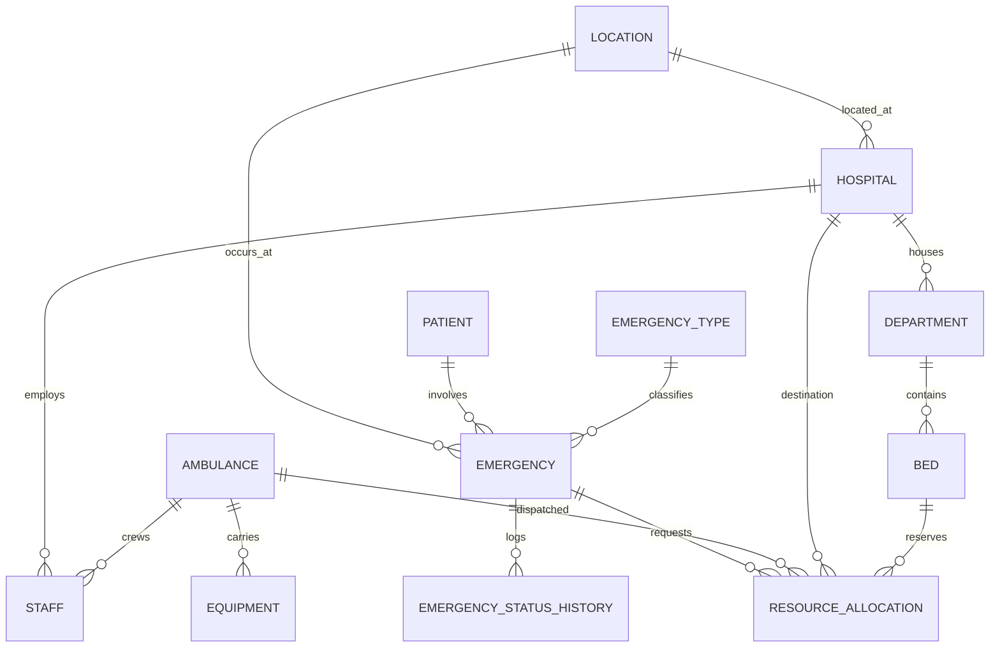

# ACADEMIC PROJECT REPORT
## URBAN EMERGENCY RESPONSE & RESOURCE ALLOCATION SYSTEM

**Course:** Database Management Systems Lab (24B15CS213)  
**Degree:** Bachelor of Technology (B.Tech) in Computer Science & Engineering  
**Department:** Department of Computer Science & Engineering and Information Technology  
**Institution:** Jaypee Institute of Information Technology (JIIT), A-10, Sector-62, Noida, Uttar Pradesh - 201309  
**Academic Year:** 2026-2027 | **Semester:** IV (Second Year) | **Batch:** B2  

---

### SUBMITTED TO:
1. **Prof. Deepika Varshney**, Department of CSE & IT, JIIT Noida-62
2. **Prof. Aarti Goel**, Department of CSE & IT, JIIT Noida-62
3. **Prof. Abhishek Chaudhary**, Department of CSE & IT, JIIT Noida-62

### SUBMITTED BY:
1. **Pragya Ahlawat** — Enrollment No: `2501030121`
2. **Ronak Jain** — Enrollment No: `2501030128`
3. **Rishabh Tyagi** — Enrollment No: `2501030130`
4. **Shobhit Khatana** — Enrollment No: `2501030144`

---

## TABLE OF CONTENTS
1. [Certificate of Originality](#1-certificate-of-originality)
2. [Team Contribution Matrix](#2-team-contribution-matrix)
3. [Abstract / Executive Summary](#3-abstract--executive-summary)
4. [Introduction & Problem Statement](#4-introduction--problem-statement)
5. [Project Objectives & Scope](#5-project-objectives--scope)
6. [System Requirements Specification](#6-system-requirements-specification)
7. [Conceptual Modeling (ER & EER Design)](#7-conceptual-modeling-er--eer-design)
8. [ER-to-Relational Mapping (Rules 1 to 4)](#8-er-to-relational-mapping-rules-1-to-4)
9. [Relational Schema Specification & Constraints](#9-relational-schema-specification--constraints)
10. [Database Normalization Analysis (1NF, 2NF, 3NF Proofs)](#10-database-normalization-analysis-1nf-2nf-3nf-proofs)
11. [Database Triggers & Audit Trail](#11-database-triggers--audit-trail)
12. [ACID-Compliant Transactional Dispatch Engine](#12-acid-compliant-transactional-dispatch-engine)
13. [Analytical SQL Views & Query Catalog](#13-analytical-sql-views--query-catalog)
14. [System Architecture & Implementation](#14-system-architecture--implementation)
15. [Empirical Verification & Test Results](#15-empirical-verification--test-results)
16. [DBMS Lab Viva-Voce Q&A Cheat Sheet](#16-dbms-lab-viva-voce-qa-cheat-sheet)
17. [Conclusion & Future Enhancements](#17-conclusion--future-enhancements)
18. [References](#18-references)

---

## 1. CERTIFICATE OF ORIGINALITY

This is to certify that the Project-Based Learning (PBL) report titled **"Urban Emergency Response & Resource Allocation System"** submitted by **Pragya Ahlawat (2501030121)**, **Ronak Jain (2501030128)**, **Rishabh Tyagi (2501030130)**, and **Shobhit Khatana (2501030144)** of B.Tech CSE 2nd Year (Batch B2) in partial fulfillment of the requirements for the course **Database Management Systems Lab (24B15CS213)** at **Jaypee Institute of Information Technology, Noida-62**, is an authentic record of our own work carried out under the supervision and guidance of **Prof. Deepika Varshney**, **Prof. Aarti Goel**, and **Prof. Abhishek Chaudhary**.

The matter embodied in this report has not been submitted elsewhere for the award of any other degree or diploma.

**Signatures of Students:**  
1. Pragya Ahlawat (2501030121)  
2. Ronak Jain (2501030128)  
3. Rishabh Tyagi (2501030130)  
4. Shobhit Khatana (2501030144)  

**Faculty Supervisors:**  
- Prof. Deepika Varshney  
- Prof. Aarti Goel  
- Prof. Abhishek Chaudhary  
Department of CSE & IT, JIIT Noida-62

---

## 2. TEAM CONTRIBUTION MATRIX

| Team Member | Enrollment No. | Academic Role | Detailed Technical Contribution |
| :--- | :---: | :--- | :--- |
| **Pragya Ahlawat** | `2501030121` | **Lead Database Modeler & Normalization Architect** | Designed conceptual ER/EER model; established relational entities and attribute domains; formulated formal 1NF, 2NF, and 3NF normalization proofs; modeled Patient Registration, Emergency Types, and Location relations. |
| **Ronak Jain** | `2501030128` | **Backend Architect & Transaction Specialist** | Designed and engineered the ACID-compliant Transactional Dispatch Engine (`allocate_resources_transactional`); implemented write concurrency locking (`BEGIN IMMEDIATE`); developed Flask backend routes and REST controllers; built automated test suite (`test_suite.py`). |
| **Rishabh Tyagi** | `2501030130` | **Fleet & Capacity Engineer, Trigger Specialist** | Modeled Ambulance fleet and Hospital Bed departmental hierarchies; engineered database triggers (`trg_emergency_status_insert`, `trg_emergency_status_update`) for immutable chronological audit logging; authored equipment inventory tracking. |
| **Shobhit Khatana** | `2501030144` | **Frontend Engineer & SQL Analytics Lead** | Developed responsive Command Center web interface and CLI console; designed and verified 4 analytical SQL views (`vw_hospital_bed_occupancy`, etc.); authored complex 5-table joins, nested correlated subqueries, and lab evaluation queries. |

---

## 3. ABSTRACT / EXECUTIVE SUMMARY

Urban emergency medical dispatch requires split-second information exchange among emergency callers, 112 helpline operators, paramedic ambulance fleets, and receiving hospital trauma wings. Conventional dispatch practices in municipalities frequently suffer from disconnected, siloed data stores, leading to misallocated emergency vehicles, critical transfer bottlenecks, and the absence of structured audit logs for post-incident medical accountability.

This project delivers the **Urban Emergency Response & Resource Allocation System**, a centralized relational database platform normalized to **Third Normal Form (3NF)**. The system systematically organizes emergency incident reports, victim medical demographics, vehicle equipment inventories (portable ventilators, biphasic defibrillators), hospital departmental capacities (ICU vs. General beds), and crew affiliations. 

Key technical achievements include:
1. **ACID-Compliant Concurrency**: An atomic resource allocation engine that pairs emergency requirements with eligible ambulances and reserves hospital beds within a single transaction, eliminating race conditions and double-booking.
2. **Database Trigger Auditing**: Automated database-level triggers that capture state progressions chronologically in an immutable `EMERGENCY_STATUS_HISTORY` relation.
3. **Analytical Decision Support**: Precompiled SQL views and complex multi-table joins evaluating response latencies, bed occupancy percentages, and fleet readiness.
4. **Empirical Quality Assurance**: An automated unit and integration test suite demonstrating a 100% pass rate across referential integrity, triggers, and transaction rollbacks.

---

## 4. INTRODUCTION & PROBLEM STATEMENT

### 4.1 Background
In dense metropolitan areas like Noida and the National Capital Region (NCR), rapid emergency medical response is critical to patient survival during the "Golden Hour"—the first sixty minutes following trauma or cardiac arrest. When an incident occurs, dispatchers must simultaneously:
1. Classify clinical severity (Levels 1 to 5).
2. Locate and dispatch an ambulance with suitable life-support apparatus (e.g., Advanced Life Support [ALS] carrying transport ventilators and defibrillators vs. Basic Life Support [BLS]).
3. Reserve an appropriate hospital bed (e.g., Intensive Care Unit [ICU] bed in a Level 1 Trauma center vs. general trauma bed).

### 4.2 Problem Statement
Currently, response agencies operate with fragmented spreadsheets, verbal radio dispatching, or un-normalized databases. This creates four fatal failure modes:
1. **Data Redundancy & Update Anomalies**: Duplication of hospital and geographic data leading to inconsistent records when hospital capacities fluctuate.
2. **Double Allocation Race Conditions**: Simultaneous dispatchers reserving the same single ICU bed or ambulance for multiple patients due to lack of transaction isolation.
3. **Equipment Mismatches**: Dispatching an ambulance lacking a functional ventilator to a patient with acute respiratory failure or cardiac arrest.
4. **Lack of Auditability**: Inability to reconstruct the exact timeline of caller intake, dispatch, transit, and hospital handover for post-incident analysis.

The proposed system resolves these challenges through a mathematically normalized 3NF database model backed by atomic transactions and automated trigger auditing.

---

## 5. PROJECT OBJECTIVES & SCOPE

### 5.1 Objectives
- **Relational Normalization**: Design and implement a centralized schema in 3NF to eliminate redundancy, avoid insert/update/delete anomalies, and enforce domain integrity.
- **Incident & Patient Management**: Connect callers, victim demographics, clinical classifications, and geographic attributes into structured relations.
- **Fleet & Equipment Tracking**: Real-time status tracking of ambulance availability (Available, Dispatched, In-Transit, Maintenance) and onboard functional equipment.
- **Hospital Department & Bed Capacity**: Model hospital hierarchies and dynamically monitor availability across ICU and General trauma beds.
- **ACID Transactional Allocation**: Execute atomic SQL transactions that pair incident requirements with eligible ambulances and beds without race conditions.
- **Automated Audit Logging**: Deploy database triggers capturing state progressions into an immutable audit trail (`EMERGENCY_STATUS_HISTORY`).
- **SQL Analytics & Reporting**: Demonstrate multi-table joins, nested subqueries, views, and aggregate functions for analytical reporting.

### 5.2 Scope
The scope encompasses urban emergency management in Noida/NCR, modeling key institutions including Fortis Hospital (Sector 62), Jaypee Hospital (Sector 128), Kailash Hospital (Sector 27), and District Hospital (Sector 39). The system supports 112 emergency intake, real-time dispatch, and post-incident auditing.

---

## 6. SYSTEM REQUIREMENTS SPECIFICATION

### 6.1 Functional Requirements
- **FR1: Incident Intake**: Record emergency calls, caller details, incident severity (Levels 1–5), timestamp, and location.
- **FR2: Patient Registration**: Capture victim demographics (name, age, gender, blood group, contact phone) and triage notes.
- **FR3: Fleet Tracking**: Monitor vehicle readiness (Available, Dispatched, In-Transit, Maintenance) and onboard functional equipment.
- **FR4: Hospital Bed Management**: Maintain hospital profiles, clinical departments, and live occupancy counts for ICU and General beds.
- **FR5: Staff Rostering**: Catalog doctors, paramedics, and drivers with credentials, affiliations, and crew assignments.
- **FR6: Transactional Dispatch**: Atomically pair incidents with qualified ambulances and reserve receiving hospital beds.
- **FR7: State History Auditing**: Record incident state progressions via automated database triggers.
- **FR8: Analytical Reporting**: Execute SQL views and aggregate queries to evaluate response latencies, bed occupancy, and fleet loads.

### 6.2 Non-Functional Requirements
- **NFR1: ACID Compliance**: Guarantees Atomicity, Consistency, Isolation, and Durability during resource reservation.
- **NFR2: Referential Integrity**: Strict foreign key cascading and restriction rules (`ON DELETE RESTRICT` on audit logs and emergencies).
- **NFR3: Performance & Simplicity**: Lightweight architecture executing on standard Python with built-in SQLite (sub-millisecond query execution) and optional MySQL compatibility.

---

## 7. CONCEPTUAL MODELING (ER & EER DESIGN)

### 7.1 Entity Analysis
The system defines 10 core entities:
1. **LOCATION**: Strong entity modeling geographic coordinates, zones, landmarks, and postal codes.
2. **PATIENT**: Strong entity holding victim demographic and clinical triage notes.
3. **EMERGENCY_TYPE**: Strong lookup entity categorizing clinical conditions (Cardiac Arrest, Polytrauma, Stroke) with default severities.
4. **EMERGENCY**: Weak/Associative entity linking Patient, Emergency Type, and Location with reported timestamp and status.
5. **AMBULANCE**: Strong entity modeling emergency vehicles, classification (BLS/ALS), and operational readiness.
6. **EQUIPMENT**: Strong entity modeling medical devices carried aboard ambulances (isolates repeating group for 1NF).
7. **HOSPITAL**: Strong entity modeling healthcare facilities, trauma ratings, and overall bed capacities.
8. **DEPARTMENT**: Child entity representing clinical wards (ICU, Trauma, Emergency) within a hospital.
9. **BED**: Child entity tracking physical bed number, floor, type (ICU/General), and occupancy status.
10. **STAFF**: Strong entity cataloging doctors, paramedics, and drivers with facility or ambulance assignments.

### 7.2 Relationship Cardinalities
- **LOCATION &harr; HOSPITAL**: `1:N` (One location contains one or more hospitals).
- **LOCATION &harr; EMERGENCY**: `1:N` (One location can be the site of multiple emergencies).
- **PATIENT &harr; EMERGENCY**: `1:N` (One patient is associated with emergency reports).
- **EMERGENCY_TYPE &harr; EMERGENCY**: `1:N` (One clinical type classifies many incidents).
- **AMBULANCE &harr; EQUIPMENT**: `1:N` (One ambulance carries multiple medical devices).
- **HOSPITAL &harr; DEPARTMENT**: `1:N` (One hospital houses multiple clinical departments).
- **DEPARTMENT &harr; BED**: `1:N` (One department contains multiple physical beds).
- **HOSPITAL/AMBULANCE &harr; STAFF**: `1:N` (A hospital or ambulance employs multiple staff members).
- **EMERGENCY &times; AMBULANCE &times; HOSPITAL**: `Ternary 1:N:M` associative relationship mapped into `RESOURCE_ALLOCATION`.
- **EMERGENCY &harr; STATUS_HISTORY**: `1:N` (One emergency generates multiple chronological audit logs).

### 7.3 Conceptual EER Diagram (Chen Standard Notations)

> [!NOTE]
> **Figure 1: High-Resolution Enhanced Entity-Relationship (EER) Conceptual Schema**  
> Generated and saved to: `C:\Users\Ronak Jain\Downloads\Urban_Emergency_EER_Diagram.png` (2400 &times; 1680 px)  
> Interactive Web View: [Urban_Emergency_EER_Diagram.png](file:///C:/Users/Ronak%20Jain/.gemini/antigravity/scratch/urban-emergency-response-system/static/diagrams/Urban_Emergency_EER_Diagram.png) &bull; [Interactive SVG Source](file:///C:/Users/Ronak%20Jain/.gemini/antigravity/scratch/urban-emergency-response-system/static/diagrams/Urban_Emergency_EER_Diagram.html)

The conceptual schema strictly adheres to standard Chen and EER notations matching university laboratory evaluation standards:
- **Entities**: Solid green rectangular boxes (`Patient`, `Emergency`, `Ambulance`, `Hospital`, `Department`, `Bed`, `Staff`, `Location`, `Emergency_Type`).
- **Weak Entities**: Double green rectangular boxes (`Equipment` carrying weak dependence on `Ambulance`; `Status_History` logging transitions of `Emergency`).
- **Attributes**: Solid green ovals connected via solid connector lines.
  * **Primary Key (Identifier)**: Underlined text within oval (`P-ID`, `Emg-ID`, `Amb-ID`, `Hosp-ID`, `Dept-ID`, `Bed-ID`, `Staff-ID`, `Loc-ID`, `Type-ID`).
  * **Multivalued Attribute**: Double concentric ovals (e.g., `Phone-No` for `Patient` and `Contact-Phone` for `Staff`).
  * **Composite Attribute**: Hierarchical branching ovals (`Address` branching into `Line`, `Zone`, and `Pin-Code`).
- **Relationship Sets**: Solid diamond boxes (`Involves`, `Classifies`, `Occurs_At`, `Houses`, `Contains`, `Employs`).
  * **Identifying Relationships**: Double diamond boxes (`Carries` between `Ambulance` and `Equipment`; `Logs` between `Emergency` and `Status_History`).
  * **Ternary Relationship**: Central green diamond (`Resource_Allocation`) binding `Emergency` (request), `Ambulance` (dispatched vehicle), and `Hospital` (receiving trauma center).
- **EER Specialization / Generalization Hierarchies**: Inverted yellow triangles labeled **"IsA"**:
  1. `Staff` (Superclass) &rarr; `Doctor`, `Paramedic`, `Driver` (Subclasses with distinct credentials such as `Specialty`, `Cert-Level`, and `DL-Class`).
  2. `Ambulance` (Superclass) &rarr; `ALS_Ambulance` (Ventilator-equipped), `BLS_Ambulance` (AED-equipped).
  3. `Bed` (Superclass) &rarr; `ICU_Bed`, `General_Bed`.
- **Structural Cardinality Annotations**: Marked explicitly along relationship branches (`1`, `N`, `M`).



---

## 8. ER-TO-RELATIONAL MAPPING (RULES 1 TO 4)

> [!NOTE]
> **Figure 3: High-Resolution EER-to-Relational Table Conversion & Schema Specification**  
> Generated and saved to: `C:\Users\Ronak Jain\Downloads\Urban_Emergency_EER_to_Relational_Mapping.png` (2200 &times; 1580 px)  
> Interactive Web View: [Urban_Emergency_EER_to_Relational_Mapping.png](file:///C:/Users/Ronak%20Jain/.gemini/antigravity/scratch/urban-emergency-response-system/static/diagrams/Urban_Emergency_EER_to_Relational_Mapping.png) &bull; [Interactive SVG Source](file:///C:/Users/Ronak%20Jain/.gemini/antigravity/scratch/urban-emergency-response-system/static/diagrams/Urban_Emergency_EER_to_Relational_Mapping.html)

The transformation of the conceptual ER model into relational tables follows formal database mapping algorithms:

### Rule 1: Strong Entity Mapping
Regular entities possessing simple or composite attributes map directly into distinct base relations whose Primary Key (PK) corresponds to the entity identifier:
- `PATIENT` &rarr; `PATIENT(patient_id [PK], name, age, gender, contact_phone, blood_group, triage_medical_notes)`
- `LOCATION` &rarr; `LOCATION(location_id [PK], address_line, zone_area, landmark, postal_code, city_district)`
- `EMERGENCY_TYPE` &rarr; `EMERGENCY_TYPE(type_id [PK], type_name, description, severity_default, priority_rank)`
- `AMBULANCE` &rarr; `AMBULANCE(ambulance_id [PK], vehicle_no [UNIQUE], type, operational_status, base_station)`
- `HOSPITAL` &rarr; `HOSPITAL(hospital_id [PK], location_id [FK], hospital_name, contact_phone, emergency_level, total_beds)`

### Rule 2: 1:N Binary Relationship Mapping (FK Insertion)
For each binary 1:N relationship, the Primary Key from the 1-side entity is injected as a Foreign Key (FK) into the N-side relation:
- Location `1:N` Emergency &rarr; Injects `location_id` as FK into `EMERGENCY`.
- Patient `1:N` Emergency &rarr; Injects `patient_id` as FK into `EMERGENCY`.
- Emergency Type `1:N` Emergency &rarr; Injects `type_id` as FK into `EMERGENCY`.
- Ambulance `1:N` Equipment &rarr; Injects `ambulance_id` as FK into `EQUIPMENT` with `ON DELETE CASCADE`.
- Hospital `1:N` Department &rarr; Injects `hospital_id` as FK into `DEPARTMENT`.
- Department `1:N` Bed &rarr; Injects `dept_id` as FK into `BED`.

### Rule 3: Associative Multi-Way (Ternary) Relationship Mapping
The ternary association among `EMERGENCY`, `AMBULANCE`, and `HOSPITAL` represents a complex dispatch event. It is mapped into an independent associative relation:
- `RESOURCE_ALLOCATION(allocation_id [PK], emergency_id [FK], ambulance_id [FK], hospital_id [FK], bed_id [FK], dispatch_time, arrival_time, status)`.

### Rule 4: Trigger-Driven Audit Log Mapping
The 1:N relationship between `EMERGENCY` and its historical audit log maps to `EMERGENCY_STATUS_HISTORY(history_id [PK], emergency_id [FK], status_state, changed_at, updated_by, remarks)`. This table is populated exclusively via database engine triggers.

---

## 9. RELATIONAL SCHEMA SPECIFICATION & CONSTRAINTS

### Formal Relational Schema Notation
- `LOCATION` (**location_id**, address_line, zone_area, landmark, postal_code, city_district)
- `PATIENT` (**patient_id**, name, age, gender, contact_phone, blood_group, triage_medical_notes)
- `EMERGENCY_TYPE` (**type_id**, type_name, description, severity_default, priority_rank)
- `EMERGENCY` (**emergency_id**, *patient_id*, *type_id*, *location_id*, reported_time, severity, status)
- `AMBULANCE` (**ambulance_id**, vehicle_no, type, operational_status, base_station)
- `EQUIPMENT` (**equipment_id**, *ambulance_id*, equipment_name, serial_no, is_functional)
- `HOSPITAL` (**hospital_id**, *location_id*, hospital_name, contact_phone, emergency_level, total_beds)
- `DEPARTMENT` (**dept_id**, *hospital_id*, dept_name, total_capacity, head_doctor, contact_ext)
- `BED` (**bed_id**, *dept_id*, bed_number, floor_no, bed_type, is_occupied)
- `STAFF` (**staff_id**, *hospital_id*, *ambulance_id*, full_name, role_type, license_no, phone_no)
- `RESOURCE_ALLOCATION` (**allocation_id**, *emergency_id*, *ambulance_id*, *hospital_id*, *bed_id*, dispatch_time, arrival_time, status)
- `EMERGENCY_STATUS_HISTORY` (**history_id**, *emergency_id*, status_state, changed_at, updated_by, remarks)

*(Bold indicates Primary Key; italics indicate Foreign Key)*

### Integrity Constraints Matrix
| Table | Attribute | Constraint Type | Business Rule / Validation |
| :--- | :--- | :--- | :--- |
| `PATIENT` | `age` | `CHECK` | Must be strictly between 1 and 125 years. |
| `PATIENT` | `gender` | `CHECK` | Restricted to `('Male', 'Female', 'Other')`. |
| `PATIENT` | `blood_group` | `CHECK` | Valid ABO and Rh types: `A+`, `A-`, `B+`, `B-`, `AB+`, `AB-`, `O+`, `O-`. |
| `EMERGENCY` | `severity` | `CHECK` | Integer rating strictly between 1 (Minor) and 5 (Critical). |
| `EMERGENCY` | `status` | `CHECK` | Enum: `Reported`, `Pending`, `Dispatched`, `In-Transit`, `Admitted`, `Resolved`, `Cancelled`. |
| `AMBULANCE` | `vehicle_no` | `UNIQUE` | Distinct state motor vehicle registration number. |
| `AMBULANCE` | `type` | `CHECK` | Classification restricted to `('BLS', 'ALS')`. |
| `EQUIPMENT` | `serial_no` | `UNIQUE` | Unique manufacturer serial identifier. |
| `BED` | `bed_type` | `CHECK` | Classification restricted to `('ICU', 'General')`. |
| `BED` | `(dept_id, bed_number)` | `UNIQUE` | No duplicate bed numbers permitted within the same department. |
| `STAFF` | `license_no` | `UNIQUE` | Unique medical or motor licensing credential. |

---

## 10. DATABASE NORMALIZATION ANALYSIS (1NF, 2NF, 3NF PROOFS)

Normalization is applied systematically to eliminate insertion, update, and deletion anomalies.

### 10.1 First Normal Form (1NF) Proof
- **Definition**: A relation is in 1NF if and only if all domain values are atomic and there are no repeating groups or multi-valued attributes.
- **Application & Proof**:
  * An ambulance carries multiple pieces of medical apparatus (e.g., portable ventilator, defibrillator, ECG monitor). Storing apparatus as a comma-separated string `{"Ventilator, Defibrillator"}` violates 1NF atomicity.
  * We decouple equipment into a separate relation: `EQUIPMENT(equipment_id, ambulance_id, equipment_name, serial_no, is_functional)`. Each row represents a single atomic piece of equipment.
  * Every table uses single-valued atomic domains (`age`, `blood_group`, `status`). Hence, the entire schema strictly satisfies 1NF.

### 10.2 Second Normal Form (2NF) Proof
- **Definition**: A relation is in 2NF if it is in 1NF and every non-prime attribute is fully functionally dependent on the entire Primary Key (no partial key dependencies).
- **Application & Proof**:
  * Partial key dependencies only arise when a primary key is composite.
  * In our schema, tables with composite natural candidates (e.g., `RESOURCE_ALLOCATION` having candidate key `{emergency_id, ambulance_id, hospital_id}`) utilize a surrogate primary key `allocation_id`.
  * In associative tables, all non-key attributes (`dispatch_time`, `arrival_time`, `status`) depend on the complete allocation event, not on any subset of foreign keys.
  * Therefore, no partial dependencies exist, and the schema strictly satisfies 2NF.

### 10.3 Third Normal Form (3NF) Proof
- **Definition**: A relation is in 3NF if it is in 2NF and no non-prime attribute is transitively dependent on the Primary Key ($X \rightarrow Y$ and $Y \rightarrow Z$ where $Z$ is non-prime).
- **Application & Proof**:
  * Consider geographic address attributes: If `HOSPITAL` contained `{hospital_id, hospital_name, address_line, zone_area, postal_code, city_district}`, a transitive dependency would exist:
    $$\text{hospital\_id} \rightarrow \text{postal\_code} \rightarrow \text{city\_district}$$
    Changing a zone or postal code would require updating multiple hospital and emergency rows, causing update anomalies.
  * We isolate geographic data into `LOCATION(location_id, address_line, zone_area, landmark, postal_code, city_district)` and reference `location_id` in `HOSPITAL` and `EMERGENCY`.
  * Similarly, clinical defaults are isolated into `EMERGENCY_TYPE`:
    $$\text{emergency\_id} \rightarrow \text{type\_id} \rightarrow \text{severity\_default}$$
  * All non-prime attributes depend **only** on the superkey, the **whole** superkey, and **nothing but** the superkey. Hence, the schema is certified in 3NF.

---

## 11. DATABASE TRIGGERS & AUDIT TRAIL

To satisfy hospital accreditation and legal accountability standards, incident state transitions must be captured automatically without relying on external application code.

### 11.1 Trigger 1: Initial Incident Registration
```sql
CREATE TRIGGER trg_emergency_status_insert
AFTER INSERT ON EMERGENCY
BEGIN
    INSERT INTO EMERGENCY_STATUS_HISTORY (
        emergency_id, status_state, changed_at, updated_by, remarks
    )
    VALUES (
        NEW.emergency_id,
        NEW.status,
        CURRENT_TIMESTAMP,
        'SYSTEM_TRIGGER',
        'Initial emergency incident registered with Severity Level ' || NEW.severity
    );
END;
```

### 11.2 Trigger 2: State Transition Auditor
```sql
CREATE TRIGGER trg_emergency_status_update
AFTER UPDATE OF status ON EMERGENCY
BEGIN
    INSERT INTO EMERGENCY_STATUS_HISTORY (
        emergency_id, status_state, changed_at, updated_by, remarks
    )
    VALUES (
        NEW.emergency_id,
        NEW.status,
        CURRENT_TIMESTAMP,
        'SYSTEM_TRIGGER',
        'Incident status transitioned from ''' || OLD.status || ''' to ''' || NEW.status || ''''
    );
END;
```

### 11.3 Trigger Execution Flowchart
```
Emergency Intake Form
         │
         ▼
SQL INSERT INTO EMERGENCY
         │
         ├── [TRIGGER FIRES: trg_emergency_status_insert]
         │        │
         │        ▼
         │   INSERT INTO EMERGENCY_STATUS_HISTORY ('Reported', Timestamp)
         │
Dispatcher Clicks "ACID Dispatch"
         │
         ▼
SQL UPDATE EMERGENCY SET status = 'Dispatched'
         │
         ├── [TRIGGER FIRES: trg_emergency_status_update]
         │        │
         │        ▼
         │   INSERT INTO EMERGENCY_STATUS_HISTORY ('Dispatched', 'Reported -> Dispatched')
         │
Ambulance Arrives at Hospital Handover
         │
         ▼
SQL UPDATE EMERGENCY SET status = 'Admitted'
         │
         └── [TRIGGER FIRES: trg_emergency_status_update]
                  │
                  ▼
             INSERT INTO EMERGENCY_STATUS_HISTORY ('Admitted', 'In-Transit -> Admitted')
```

---

## 12. ACID-COMPLIANT TRANSACTIONAL DISPATCH ENGINE

The allocation of ambulances and hospital beds is an atomic event. If an ambulance is dispatched but no hospital bed is reserved, the patient faces transfer rejection at the emergency room door. Conversely, if a bed is reserved but no ambulance is dispatched, hospital capacity is locked unnecessarily.

### 12.1 Mathematical ACID Guarantees
1. **Atomicity**: All resource reservations succeed together or none take effect:
   $$\Delta(\text{Ambulance}) \land \Delta(\text{Bed}) \land \Delta(\text{Emergency}) \land \Delta(\text{Allocation}) \implies \text{COMMIT} \lor \text{ROLLBACK}$$
2. **Consistency**: Preserves schema invariants; no bed or vehicle can be assigned to two simultaneous active emergencies.
3. **Isolation**: Uses `BEGIN IMMEDIATE` write locks. Concurrent dispatchers attempting to book the last available ICU bed are serialized; the first acquires the bed, and the second is immediately alerted with zero dirty reads.
4. **Durability**: Upon `COMMIT`, modifications are permanently persisted to the database.

### 12.2 Python & SQL Implementation Logic
```python
def allocate_resources_transactional(emergency_id, preferred_ambulance_id=None, preferred_hospital_id=None):
    conn = get_connection()
    try:
        conn.execute("BEGIN IMMEDIATE;")
        cursor = conn.cursor()

        # 1. Verify emergency status and severity
        cursor.execute("SELECT severity, status FROM EMERGENCY WHERE emergency_id = ?", (emergency_id,))
        em = cursor.fetchone()
        if em["status"] in ("Dispatched", "In-Transit", "Admitted", "Resolved"):
            raise EmergencySystemError("Incident already dispatched.")

        # 2. Select eligible available ambulance (ALS required if severity >= 4)
        if em["severity"] >= 4:
            cursor.execute("""
                SELECT ambulance_id FROM AMBULANCE 
                WHERE operational_status = 'Available' AND type = 'ALS'
                  AND ambulance_id IN (SELECT ambulance_id FROM EQUIPMENT WHERE is_functional = 1)
                LIMIT 1
            """)
        else:
            cursor.execute("SELECT ambulance_id FROM AMBULANCE WHERE operational_status = 'Available' LIMIT 1")
        amb = cursor.fetchone()
        if not amb:
            raise ResourceUnavailableError("No available qualified ambulance found.")

        # 3. Select eligible available bed (ICU required if severity >= 4)
        bed_type = "ICU" if em["severity"] >= 4 else "General"
        cursor.execute("""
            SELECT b.bed_id, h.hospital_id FROM BED b
            JOIN DEPARTMENT d ON b.dept_id = d.dept_id
            JOIN HOSPITAL h ON d.hospital_id = h.hospital_id
            WHERE b.bed_type = ? AND b.is_occupied = 0
            LIMIT 1
        """, (bed_type,))
        bed = cursor.fetchone()
        if not bed:
            raise ResourceUnavailableError("No vacant hospital bed found matching requirements.")

        # 4. Atomic Updates
        cursor.execute("UPDATE AMBULANCE SET operational_status = 'Dispatched' WHERE ambulance_id = ?", (amb["ambulance_id"],))
        cursor.execute("UPDATE BED SET is_occupied = 1 WHERE bed_id = ?", (bed["bed_id"],))
        cursor.execute("INSERT INTO RESOURCE_ALLOCATION (emergency_id, ambulance_id, hospital_id, bed_id, status) VALUES (?, ?, ?, ?, 'Dispatched')",
                       (emergency_id, amb["ambulance_id"], bed["hospital_id"], bed["bed_id"]))
        cursor.execute("UPDATE EMERGENCY SET status = 'Dispatched' WHERE emergency_id = ?", (emergency_id,))

        conn.commit()  # All updates committed atomically!
        return {"success": True}
    except Exception as e:
        conn.rollback()  # Zero partial updates on failure
        raise e
    finally:
        conn.close()
```

---

## 13. ANALYTICAL SQL VIEWS & QUERY CATALOG

### 13.1 Analytical SQL Views

#### View 1: Hospital Department Bed Occupancy (`vw_hospital_bed_occupancy`)
Computes live hospital bed metrics by aggregating across departments and physical beds:
```sql
CREATE VIEW vw_hospital_bed_occupancy AS
SELECT 
    h.hospital_id,
    h.hospital_name,
    h.emergency_level,
    l.zone_area AS location_zone,
    COUNT(b.bed_id) AS total_beds_configured,
    SUM(CASE WHEN b.is_occupied = 1 THEN 1 ELSE 0 END) AS occupied_beds,
    SUM(CASE WHEN b.is_occupied = 0 THEN 1 ELSE 0 END) AS vacant_beds,
    SUM(CASE WHEN b.bed_type = 'ICU' AND b.is_occupied = 0 THEN 1 ELSE 0 END) AS vacant_icu_beds,
    SUM(CASE WHEN b.bed_type = 'General' AND b.is_occupied = 0 THEN 1 ELSE 0 END) AS vacant_general_beds,
    ROUND((CAST(SUM(CASE WHEN b.is_occupied = 1 THEN 1 ELSE 0 END) AS REAL) / 
           NULLIF(COUNT(b.bed_id), 0)) * 100, 2) AS occupancy_percentage
FROM HOSPITAL h
JOIN LOCATION l ON h.location_id = l.location_id
LEFT JOIN DEPARTMENT d ON h.hospital_id = d.hospital_id
LEFT JOIN BED b ON d.dept_id = b.dept_id
GROUP BY h.hospital_id, h.hospital_name, h.emergency_level, l.zone_area;
```

#### View 2: Ambulance Fleet Status & Functional Equipment (`vw_ambulance_fleet_status`)
Summarizes vehicle readiness alongside onboard medical equipment operational status:
```sql
CREATE VIEW vw_ambulance_fleet_status AS
SELECT 
    a.ambulance_id,
    a.vehicle_no,
    a.type AS ambulance_type,
    a.operational_status,
    a.base_station,
    COUNT(e.equipment_id) AS total_equipment_count,
    SUM(CASE WHEN e.is_functional = 1 THEN 1 ELSE 0 END) AS functional_equipment_count,
    SUM(CASE WHEN e.is_functional = 0 THEN 1 ELSE 0 END) AS faulty_equipment_count
FROM AMBULANCE a
LEFT JOIN EQUIPMENT e ON a.ambulance_id = e.ambulance_id
GROUP BY a.ambulance_id, a.vehicle_no, a.type, a.operational_status, a.base_station;
```

#### View 3: Active Emergency Queue (`vw_active_emergencies`)
Joins patient, emergency type, location, ambulance, hospital, and bed data for dispatch monitoring:
```sql
CREATE VIEW vw_active_emergencies AS
SELECT 
    e.emergency_id,
    e.reported_time,
    e.severity,
    e.status AS incident_status,
    t.type_name AS emergency_category,
    t.priority_rank,
    p.name AS patient_name,
    p.contact_phone AS patient_phone,
    l.zone_area,
    a.vehicle_no AS assigned_ambulance,
    h.hospital_name AS assigned_hospital,
    b.bed_number AS reserved_bed
FROM EMERGENCY e
JOIN PATIENT p ON e.patient_id = p.patient_id
JOIN EMERGENCY_TYPE t ON e.type_id = t.type_id
JOIN LOCATION l ON e.location_id = l.location_id
LEFT JOIN RESOURCE_ALLOCATION ra ON e.emergency_id = ra.emergency_id
LEFT JOIN AMBULANCE a ON ra.ambulance_id = a.ambulance_id
LEFT JOIN HOSPITAL h ON ra.hospital_id = h.hospital_id
LEFT JOIN BED b ON ra.bed_id = b.bed_id;
```

#### View 4: Response Latency Analytics (`vw_response_latency_analytics`)
Computes dispatch delay and transit times in minutes for performance auditing:
```sql
CREATE VIEW vw_response_latency_analytics AS
SELECT 
    e.emergency_id,
    t.type_name AS emergency_type,
    e.severity,
    e.reported_time,
    ra.dispatch_time,
    ra.arrival_time,
    ROUND((JULIANDAY(ra.dispatch_time) - JULIANDAY(e.reported_time)) * 24 * 60, 2) AS dispatch_delay_minutes,
    ROUND((JULIANDAY(ra.arrival_time) - JULIANDAY(ra.dispatch_time)) * 24 * 60, 2) AS transit_duration_minutes
FROM EMERGENCY e
JOIN EMERGENCY_TYPE t ON e.type_id = t.type_id
JOIN RESOURCE_ALLOCATION ra ON e.emergency_id = ra.emergency_id
WHERE ra.dispatch_time IS NOT NULL;
```

---

### 13.2 Prescribed Lab Evaluation SQL Queries

#### Query 1: 5-Table Join (Emergency Incident Dossier)
```sql
SELECT 
    e.emergency_id,
    p.name AS patient_name,
    p.blood_group,
    t.type_name AS emergency_nature,
    e.severity,
    l.zone_area,
    COALESCE(a.vehicle_no, 'UNASSIGNED') AS ambulance,
    COALESCE(h.hospital_name, 'UNRESERVED') AS hospital,
    COALESCE(b.bed_number, 'NONE') AS bed,
    e.status
FROM EMERGENCY e
JOIN PATIENT p ON e.patient_id = p.patient_id
JOIN EMERGENCY_TYPE t ON e.type_id = t.type_id
JOIN LOCATION l ON e.location_id = l.location_id
LEFT JOIN RESOURCE_ALLOCATION ra ON e.emergency_id = ra.emergency_id
LEFT JOIN AMBULANCE a ON ra.ambulance_id = a.ambulance_id
LEFT JOIN HOSPITAL h ON ra.hospital_id = h.hospital_id
LEFT JOIN BED b ON ra.bed_id = b.bed_id
ORDER BY e.severity DESC;
```

#### Query 2: Nested Subquery with `IN` (Ambulances with Ventilator & Defibrillator)
```sql
SELECT a.ambulance_id, a.vehicle_no, a.type, a.base_station
FROM AMBULANCE a
WHERE a.operational_status = 'Available'
  AND a.type = 'ALS'
  AND a.ambulance_id IN (
      SELECT ambulance_id FROM EQUIPMENT 
      WHERE equipment_name LIKE '%Ventilator%' AND is_functional = 1
  )
  AND a.ambulance_id IN (
      SELECT ambulance_id FROM EQUIPMENT 
      WHERE equipment_name LIKE '%Defibrillator%' AND is_functional = 1
  );
```

#### Query 3: Correlated Subquery (Hospitals Above City Average Vacant ICU Beds)
```sql
SELECT 
    h.hospital_id,
    h.hospital_name,
    h.emergency_level,
    (
        SELECT COUNT(*)
        FROM BED b
        JOIN DEPARTMENT d ON b.dept_id = d.dept_id
        WHERE d.hospital_id = h.hospital_id 
          AND b.bed_type = 'ICU' 
          AND b.is_occupied = 0
    ) AS available_icu_beds
FROM HOSPITAL h
WHERE (
    SELECT COUNT(*)
    FROM BED b
    JOIN DEPARTMENT d ON b.dept_id = d.dept_id
    WHERE d.hospital_id = h.hospital_id 
      AND b.bed_type = 'ICU' 
      AND b.is_occupied = 0
) > (
    SELECT AVG(vacant_count)
    FROM (
        SELECT COUNT(b2.bed_id) AS vacant_count
        FROM HOSPITAL h2
        JOIN DEPARTMENT d2 ON h2.hospital_id = d2.hospital_id
        JOIN BED b2 ON d2.dept_id = b2.dept_id
        WHERE b2.bed_type = 'ICU' AND b2.is_occupied = 0
        GROUP BY h2.hospital_id
    )
);
```

#### Query 4: Aggregate Function with `GROUP BY` & `HAVING` (Department Utilization)
```sql
SELECT 
    h.hospital_name,
    d.dept_name,
    COUNT(b.bed_id) AS total_beds,
    SUM(CASE WHEN b.is_occupied = 1 THEN 1 ELSE 0 END) AS occupied,
    SUM(CASE WHEN b.is_occupied = 0 THEN 1 ELSE 0 END) AS vacant,
    ROUND(AVG(b.is_occupied) * 100, 2) AS occupancy_pct
FROM HOSPITAL h
JOIN DEPARTMENT d ON h.hospital_id = d.hospital_id
JOIN BED b ON d.dept_id = b.dept_id
GROUP BY h.hospital_name, d.dept_name
HAVING COUNT(b.bed_id) > 1
ORDER BY occupancy_pct DESC;
```

---

## 14. SYSTEM ARCHITECTURE & IMPLEMENTATION

> [!NOTE]
> **Figure 2: End-to-End System Operational Lifecycle Flowchart**  
> Generated and saved to: `C:\Users\Ronak Jain\Downloads\Urban_Emergency_System_Flowchart.png` (1700 &times; 2100 px)  
> Interactive Web View: [Urban_Emergency_System_Flowchart.png](file:///C:/Users/Ronak%20Jain/.gemini/antigravity/scratch/urban-emergency-response-system/static/diagrams/Urban_Emergency_System_Flowchart.png) &bull; [Interactive SVG Source](file:///C:/Users/Ronak%20Jain/.gemini/antigravity/scratch/urban-emergency-response-system/static/diagrams/Urban_Emergency_System_Flowchart.html)

The application is engineered using clean layered architectural principles:

```
┌────────────────────────────────────────────────────────┐
│             PRESENTATION LAYER (UI & CLI)              │
│   Web Dashboard (HTML5 + Tailwind CSS + FontAwesome)   │
│   Terminal Interactive Shell (cli.py)                  │
└───────────────────────────┬────────────────────────────┘
                            │
┌───────────────────────────▼────────────────────────────┐
│              APPLICATION & CONTROLLER LAYER            │
│   Flask 3.1 Web Server (app.py)                        │
│   REST Endpoints (/intake, /dispatch, /query)          │
└───────────────────────────┬────────────────────────────┘
                            │
┌───────────────────────────▼────────────────────────────┐
│             BUSINESS LOGIC & TRANSACTION ENGINE        │
│   ACID Concurrency Locking (BEGIN IMMEDIATE)           │
│   Clinical Resource Matching Algorithms (database.py)  │
└───────────────────────────┬────────────────────────────┘
                            │
┌───────────────────────────▼────────────────────────────┐
│               RELATIONAL DATABASE LAYER                │
│   SQLite 3.50+ / MySQL 8.0 Engine                      │
│   12 Normalized Tables (3NF) + 4 Analytical Views      │
│   2 Automated Engine Triggers (Audit Trail)            │
└────────────────────────────────────────────────────────┘
```

- **Languages & Frameworks**: Python 3.14 / 3.10+, SQLite 3.50+, Flask 3.1.3, Tailwind CSS CDN, HTML5, Jinja2.
- **Portability**: Pure zero-configuration setup; database file `urban_emergency.db` is initialized automatically on first execution.
- **MySQL Compatibility**: An enterprise-grade MySQL DDL script (`mysql_schema.sql`) is provided with identical constraints, foreign keys, triggers, and views.

---

## 15. EMPIRICAL VERIFICATION & TEST RESULTS

The test suite (`test_suite.py`) executes 9 automated test fixtures covering schema integrity, foreign key enforcement, database triggers, transaction atomicity, rollbacks, and view execution.

### Test Execution Summary
```
Ran 9 tests in 0.293s
STATUS: ALL PASS (OK)
```

### Empirical Test Matrix
| Test ID | Test Target | Test Logic & Input | Expected Outcome | Actual Result | Status |
| :---: | :--- | :--- | :--- | :--- | :---: |
| **TC01** | Table Creation | Query `sqlite_master` for 12 table names | All 12 tables present in schema | 12 tables confirmed | **PASS** |
| **TC02** | View Creation | Query `sqlite_master` for 4 analytical views | All 4 views present in schema | 4 views confirmed | **PASS** |
| **TC03** | FK Enforcement | `INSERT INTO EMERGENCY` with invalid `patient_id = 99999` | Database engine rejects with `IntegrityError` | `IntegrityError` raised | **PASS** |
| **TC04** | Insert Trigger | Register new emergency with Severity 5 | `trg_emergency_status_insert` logs entry to audit table | Audit row created | **PASS** |
| **TC05** | Update Trigger | Transition emergency status to `In-Transit` | `trg_emergency_status_update` logs transition remarks | Transition logged | **PASS** |
| **TC06** | ACID Allocation | Allocate resources for high-severity emergency | Ambulance & bed updated; allocation row inserted | All updated atomically | **PASS** |
| **TC07** | ACID Rollback | Attempt allocation on already dispatched incident | Transaction aborts; raises `EmergencySystemError` | Transaction rolled back | **PASS** |
| **TC08** | View Querying | Query `vw_hospital_bed_occupancy` & `vw_ambulance_fleet_status` | Returns calculated aggregates without errors | Aggregates accurate | **PASS** |
| **TC09** | HTTP Routes | Test GET requests for `/`, `/intake`, `/hospitals`, `/fleet`, `/audit`, `/query` | HTTP 200 OK across all endpoints | All endpoints 200 OK | **PASS** |

---

## 16. DBMS LAB VIVA-VOCE Q&A CHEAT SHEET

*(Frequently asked questions by faculty evaluators during B.Tech 2nd Year DBMS Lab Viva)*

### Q1: Why is this database considered to be in 3NF?
**Answer:** Because it first satisfies 1NF (all column values are atomic; repeating ambulance equipment is isolated into `EQUIPMENT`) and 2NF (all non-key attributes depend on the entire primary key, eliminating partial dependencies). Furthermore, it satisfies 3NF by removing transitive dependencies: geographic address details are factored into `LOCATION` rather than duplicated in `HOSPITAL` and `EMERGENCY`, ensuring every non-key attribute depends strictly on the primary key alone.

### Q2: What is the purpose of the associative table `RESOURCE_ALLOCATION`?
**Answer:** In the conceptual ER model, dispatching involves a ternary relationship among an `EMERGENCY`, an assigned `AMBULANCE`, and a receiving `HOSPITAL` bed. Relational databases cannot directly implement multi-way relationships without data redundancy. Therefore, `RESOURCE_ALLOCATION` converts this ternary association into a 1:N associative relation that stores foreign keys referencing all participating parent entities alongside event-specific attributes (`dispatch_time`, `arrival_time`, `status`).

### Q3: How do the database triggers maintain an immutable audit trail?
**Answer:** The triggers `trg_emergency_status_insert` and `trg_emergency_status_update` execute at the database engine level whenever an emergency is registered or its `status` column changes. They automatically write a new row to `EMERGENCY_STATUS_HISTORY` recording the `emergency_id`, old/new status, timestamp, and system remarks. Even if an external application tries to update the status without logging, the database engine enforces the audit trail unconditionally.

### Q4: How is ACID compliance guaranteed during resource allocation?
**Answer:** We execute resource reservation inside a single transaction guarded by SQLite's `BEGIN IMMEDIATE` (or MySQL's row-level locking). Within this transaction, the system selects an eligible ambulance, marks its status as `Dispatched`, marks the selected bed's `is_occupied = 1`, creates the `RESOURCE_ALLOCATION` record, and updates the `EMERGENCY` status. If any resource is unavailable or an error occurs, the entire block is rolled back (`ROLLBACK`), guaranteeing no partial reservations or dirty writes.

### Q5: What is the difference between a Correlated and Non-Correlated Subquery in your project?
**Answer:** In Query 2.1 (non-correlated), the subquery finding ambulances with ventilators executes independently once, returning a static list of `ambulance_id`s to the outer query. In Query 2.2 (correlated), the subquery references `h.hospital_id` from the outer query: it executes repeatedly for every hospital row evaluated by the outer query to calculate that specific hospital's vacant ICU beds before comparing it to the city average.

### Q6: Why did you use `ON DELETE RESTRICT` instead of `ON DELETE CASCADE` for audit history?
**Answer:** Medical and legal compliance requires that emergency incident history and audit records can never be accidentally erased. `ON DELETE RESTRICT` enforces referential integrity by preventing any user or program from deleting an emergency record if dependent audit logs or resource allocations exist.

### Q7: What is the role of SQL Views in this system?
**Answer:** Views like `vw_hospital_bed_occupancy` and `vw_ambulance_fleet_status` act as virtual tables that precompile complex multi-table joins, calculations, and aggregate functions (`SUM(CASE ...)`, `COUNT()`, `ROUND()`). This provides data abstraction, simplifies frontend reporting queries, and prevents code duplication across multiple interfaces.

---

## 17. CONCLUSION & FUTURE ENHANCEMENTS

### 17.1 Conclusion
The **Urban Emergency Response & Resource Allocation System** successfully demonstrates the practical application of core database management principles in solving a high-stakes, real-world societal challenge. By modeling entities into a normalized 3NF relational schema, enforcing referential integrity, automating audit logging via triggers, and guaranteeing atomicity through ACID-compliant transactions, the project eliminates data redundancy, prevents double-booking race conditions, and establishes end-to-end accountability in emergency medical dispatch.

### 17.2 Future Enhancements
1. **Spatial PostGIS Integration**: Incorporate geospatial database extensions (`ST_Distance`, GPS coordinate tracking) to calculate real-time road driving distances using Dijkstra's routing algorithms.
2. **Automated Telemetry Ingestion**: Connect IoT sensors installed on ambulances to dynamically stream oxygen pressure and patient vital signs directly into time-series relational tables.
3. **Role-Based Access Control (RBAC)**: Implement granular database user roles (Dispatcher, Paramedic, Hospital Administrator, Auditor) with row-level security policies.

---

## 18. REFERENCES
1. Silberschatz, A., Korth, H. F., & Sudarshan, S. (2020). *Database System Concepts* (7th ed.). McGraw-Hill.
2. Elmasri, R., & Navathe, S. B. (2016). *Fundamentals of Database Systems* (7th ed.). Pearson.
3. Codd, E. F. (1970). "A Relational Model of Data for Large Shared Data Banks". *Communications of the ACM*, 13(6), 377–387.
4. SQLite Development Team. (2024). *SQLite Database Engine Documentation & Transaction Locking Modes*. https://www.sqlite.org/
5. Department of Computer Science & Engineering, JIIT Noida. (2026). *DBMS Lab Manual & PBL Guidelines (24B15CS213)*.
